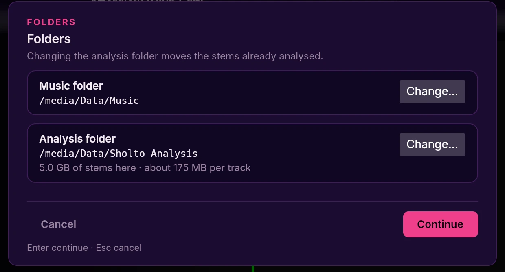

# The library

The top half of the window. Every track Sholto found in your music folder, one
row each, newest analysis showing as it lands.

## The columns

| Column | What it shows |
|---|---|
| **ANALYZED** | A moving bar while the track is being analysed, then a tick |
| **TAGS** | A 🏷 chip with the number of tags on that track (hidden if it has none) |
| **ARTIST** | The artist tag from the file |
| **TRACK** | The title. Tracks you've loaded this session go *italic* and dim, so you can see what you've already played |
| **BPM** | The detected tempo, including any ½ / ×2 correction you made |
| **KEY** | The Camelot key, on a coloured chip. Chips that mix harmonically with what's playing get a white outline |
| **TIME** | Track length |

The tick in **ANALYZED** only appears when a track is *fully* done — tempo and
beats **and** stems. A track with beats but no stems yet still shows as
unanalysed, and it will play fine.

## Choosing a track

**On screen:** click a row to highlight it. Clicking does *not* load it.
**Controller:** turn the browse knob to scroll the Track List.
**Keyboard:** **↑ / ↓**.

## Loading a track

**Controller:** **LOAD 1** or **LOAD 2** loads the highlighted track.
**Keyboard:** **1** or **2**.

The deck shows the title straight away and fills in once the audio has decoded.
It won't play until the beat detection has finished — usually a second or two.

## Folders

**Settings → Folders…** opens one panel with two rows, **Music folder** and **Analysis folder**. Each row shows its path and has its own **Change…** button. Changing one never changes the other.

- **Music folder** — where Sholto looks for your tracks.
- **Analysis folder** — where Sholto keeps the separated stems (drums, vocals, bass, other). They take about 175 MB per track, so a big library needs room; the row shows how much is there now. Your library data (tracks, tags, crates, markers) stays in `~/.local/share/sholto`.

Press **Continue** to use the folders shown, or **Cancel** to change nothing.

**New install.** The panel opens on first run, asking "Where are your music and analysis folders?". Pick your music folder and the analysis folder follows it, as a folder called **Sholto Analysis** next to it. Until you pick an analysis folder yourself, it keeps following the music folder. **Continue** works once both rows are fine.

**Updating from an earlier version.** You see the panel once, titled "Choose where Sholto keeps its analysis". It says where the stems are now and how much space they take. Press **Continue** to keep that folder, or change it.

**Moving the analysis folder.** Pick a new one and press **Continue**: Sholto moves your existing stems there. On the same drive this is instant. On another drive Sholto copies them, checks every file, then deletes the old copy, and the panel shows progress ("Moving stems: 12 of 29 track folders"). If something goes wrong, the old copy is kept and the panel says why. Tracks keep their ticks and are not analysed again. Decks that are already loaded keep playing.

**Rules.** The analysis folder cannot be the music folder, be inside it or contain it, because Sholto would then list the stems as tracks. It must be a folder Sholto can write to. A row that breaks a rule says so in red, and **Continue** stays off.

**Drive not connected.** If either folder is on a drive that isn't connected when Sholto starts, the panel opens titled "A folder can't be reached — reconnect the drive or choose another", and that row reads "Not found. Is the drive mounted?". Reconnect the drive and choose the folder again, or pick another. If you choose **Not now**, Sholto keeps the saved folders for next time; a missing music folder shows the banner over the track list (its **Choose folder…** button opens this panel), and with the analysis folder missing, stems stay off for that session. Sholto never writes them somewhere else instead.

**One question at a time.** The Folders panel and the output device picker never show together. On first run the folders come first and the output device after. While one is open, **Settings → Folders…** and **Settings → Output device…** do nothing.

**Environment overrides.** If `SHOLTO_MUSIC_DIR` or `SHOLTO_CACHE_ROOT` is set, that row is fixed: its button reads "Set by SHOLTO_MUSIC_DIR" or "Set by SHOLTO_CACHE_ROOT" and can't be pressed. `SHOLTO_CACHE_ROOT` sets the analysis folder and is not saved.

## Search

**Keyboard:** **Space** opens search from anywhere.

Type part of a name, the initials (`iltwykm` finds "I Like The Way You Kiss Me"),
`bpm:128`, `key:8A` or `#tag`. Search covers your whole library and ranks the
tracks that fit the other deck first: green is a good fit, amber usable, grey a
clash. **Enter** loads the highlighted track, and **Esc** closes.

Everything you can type, how the list is ordered, and every key: [search.md](search.md).

## The actions menu

**Keyboard:** **Enter** on a highlighted row.

| Item | Key |
|---|---|
| 📦 Add to crate | **C** |
| 🏷 Tag | **T** |

**↑ / ↓** moves, **Enter** picks, **Esc** closes.

## Tags

**On screen:** click the 🏷 chip in a row's TAGS column to open the tag editor for
that track.
**Keyboard:** **Enter** then **T** does the same for the highlighted row.

In the editor, type a tag and press **Enter** to add it (**Tab** adds it and
keeps typing), **↑ / ↓** picks from the suggestions, **Backspace** on an empty box
removes the last tag, and **Esc** closes. Existing tags are listed under
**TAGGED** with an **×** to remove each one.

To see everything with a tag: press **Space**, type the tag, and press
**Ctrl + L** on it under 🏷 TAGS. Its songs are added to the
[Track List](#the-track-list). (**Enter** instead narrows the search results to
it; see [search.md](search.md#narrowing-to-a-crate-or-tag).)

## Crates

Crates are your record boxes. **All Tracks** is a real crate that always holds
everything.

**On screen / keyboard:** **Enter** on a row, then **C**, to add it to a crate.
The picker lists your crates — type to filter, **Enter** adds to the highlighted
crate or creates one with the name you typed, **Esc** closes.

To open a crate: **Space**, type its name, **Ctrl + L** on it under 📦 CRATES.
Its songs are added to the [Track List](#the-track-list).

## The Track List

The main view's list is the **Track List**. Search loads into it with
**Ctrl + L**; loads add to it and never replace it, and a song is never listed
twice. On first launch it holds **All Tracks**, and it is kept when you restart.

- The strip above it shows what you've loaded: a crate, a tag, or single songs.
  Click a source's **×** to remove the songs it brought in.
- Drag the grip at the left of a row to reorder.
- **Delete** removes the highlighted song.
- **Ctrl + Del**, pressed twice in search, clears the whole list.

## Analysis

Sholto analyses each track once and remembers it, so it's instant every time
after. A track goes through tempo and beats, then key, then stems (drums, vocals,
bass, other), then the song sections.

- A small moving bar in **ANALYZED** means something is running for that row.
- A tick means tempo, beats **and** stems are all done.
- Stems need **demucs** installed; song sections use a simpler built-in guess.

**Re-analyse a track** — for the odd one whose beats came out wrong:

**On screen:** double-click the row.
**Controller:** hold the browse knob on it for about a second.

That recomputes tempo, beats and key from scratch and overwrites what was
stored, then separates the stems too, so the row ends up ticked. Stems
already on disk are reused, not recomputed, and a separation waits its turn
behind any other one running (such as a deck load).

## BPM and key

The **BPM** column shows the detected tempo with your ½ / ×2 correction applied
— see [correcting the tempo](deck.md#beatgrid) on the deck page. The correction
is remembered per track.

The **KEY** column is the Camelot code. Its colour follows the usual DJ
convention, so keys that sit next to each other on the wheel look alike. Once a
deck has a key loaded, every chip in the library that mixes harmonically with it
gains a white outline.
